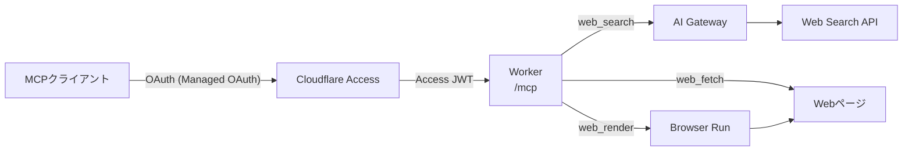

# webtools-mcp

[English](README.md)

コーディングエージェントにWebへのアクセスを与える、Cloudflare Workers上のリモート[MCP](https://modelcontextprotocol.io)サーバーです。Webの検索、ページの読み込み、JavaScriptが必要なページの描画ができます。クライアントはCloudflare AccessにOAuthでサインインするので、使えるのは自分だけです。



## ツール

| ツール       | すること                                                                                                                              | 使うもの                                                                                                                         |
| ------------ | ------------------------------------------------------------------------------------------------------------------------------------- | -------------------------------------------------------------------------------------------------------------------------------- |
| `web_search` | 公開されているWebを検索し、URL、タイトル、短い説明を返す。                                                                            | [AI Gateway](https://developers.cloudflare.com/ai-gateway/)経由の[Web Search API](https://developers.cloudflare.com/web-search/) |
| `web_fetch`  | URLを読み、Markdown（HTML、PDF、Office文書は変換する）、JSON、テキストのどれかで返す。長いページは`offset`で区切って読む。            | Workerからの`fetch`と[Markdown Conversion](https://developers.cloudflare.com/workers-ai/features/markdown-conversion/)           |
| `web_render` | ヘッドレスブラウザでページを開き、JavaScriptを実行してから、結果をMarkdownで読む。`web_fetch`が空のアプリの枠だけを返したときに使う。 | [Browser Run](https://developers.cloudflare.com/browser-run/)のQuick Action `/markdown`                                          |

`web_search`と`web_fetch`は、[`agents`](https://www.npmjs.com/package/agents)のAI SDK用アダプター（`agents/websearch/ai-sdk`と`agents/webfetch/ai-sdk`）を包んだものなので、説明文と結果の形式はアダプターのものをそのまま使います。

## 特徴

- Accessの後ろにあっても、WorkerはリクエストごとにAccessのJWTの署名、発行者、audienceを検証し、どれかが通らなければリクエストを拒否します。
- Workerは、検索を1分30回、ページの読み込みを1分60回、描画を1分10回までに制限します。AI Gatewayの費用の上限は検索を止めないので、検索の費用を抑えるのはこのrate limitです。
- 読み込んだページと描画したページは、`<untrusted_web_content>`で囲んでモデルに渡します。ページの中身からこのタグを閉じることはできません。
- どのツールも`outputSchema`を宣言するので、Piのcodemodeのように、コードからツールを呼ぶクライアントは型の付いた結果を受け取れます。
- サーバーの`instructions`は、3つのツールを1行で説明します。ツールを宣言せず、この1行でサーバーを紹介するクライアントのためです。

## クライアントをつなぐ

エンドポイントは`https://<your-hostname>/mcp`で、streamable HTTPで提供します。クライアントはOAuthでサインインします。Accessが返す`WWW-Authenticate`ヘッダーから認可サーバーを見つけ、自分を登録し、サインインのためにブラウザを開きます。

たとえば[Pi](https://pi.dev)では、`~/.pi/agent/mcp.json`にサーバーを加えます。

```json
{
  "mcpServers": {
    "webtools": { "url": "https://<your-hostname>/mcp" }
  }
}
```

そのうえで`pi mcp login webtools`を実行し、`pi mcp list`で確かめます。

> [!TIP]
> Piは、デフォルトではMCPのツールをモデルに宣言しません。エントリーに`"exposure": "direct"`を加えると、モデルは探さなくても3つのツールが見えるようになります。

## 自分の環境にデプロイする

### 必要なもの

- Workers Paidプランで、ドメインをCloudflareに置いているCloudflareアカウント
- [mise](https://mise.jdx.dev)（`package.json`で固定したNode.jsとpnpmの版を入れる）
- 本番へのデプロイ用に、Actionsが使えるGitHubのリポジトリ

### 1. Cloudflareを設定する

1. Workerが使うホスト名に、種類が`mcp`のAccessのアプリケーションを作ります。Managed OAuthを動的クライアント登録付きで有効にし、CLIのクライアントがサインインできるように、ループバックのリダイレクトURIを許可します。自分だけを許可するポリシーを加え、アプリケーションのAUDタグを控えます。
2. `webtools`という名前のAI Gatewayを作り、認証を有効にします。検索の費用はAI Gatewayのクレジットから払われるので、クレジットを入れておきます。

### 2. コードを自分のリソースに向ける

- `src/auth.ts`：`ACCESS_ISSUER`を、Zero Trustのチームドメイン`https://<team>.cloudflareaccess.com`にします。
- `cloudflare.config.ts`：`ACCESS_AUD`をAUDタグに、`domains`を自分のホスト名にします。Custom Domain、そのDNSレコード、証明書は、デプロイのときにWorkerが作ります。

### 3. デプロイする

`.github/workflows/deploy.yaml`は、`main`へのpushのたびに`cf deploy`を実行します。Environment `production`から、次の2つのsecretsを読みます。

| Secret                  | 値                                                                                                                                   |
| ----------------------- | ------------------------------------------------------------------------------------------------------------------------------------ |
| `CLOUDFLARE_API_TOKEN`  | アカウントのAPIトークン。権限は、アカウントにWorkers Scripts: EditとAccount Settings: Read、ゾーンにWorkers Routes: EditとZone: Read |
| `CLOUDFLARE_ACCOUNT_ID` | アカウントID                                                                                                                         |

> [!IMPORTANT]
> secretsを入れる前に、Environment `production`を`main`ブランチだけに絞ってください。ワークフローには`pull_request`のトリガーがないので、Pull Requestからsecretsに届くことはありません。

手元からデプロイする場合は、`cf auth login`でサインインし、`pnpm run deploy`を実行します。

## ローカルでの開発

```sh
mise install
pnpm install
pnpm dev
```

`pnpm dev`は`cf dev`を実行し、`http://localhost:5173/mcp`でMCPのエンドポイントを提供します。前にAccessがないので、開発モードのWorkerは、`localhost`へのリクエストに限ってJWTの検証を省きます。本番のビルドには、この抜け道は入りません。

> [!WARNING]
> Web SearchとBrowser Runにはローカルで動く仕組みがありません。`cf dev`はこれらのbindingを自分のCloudflareアカウントにつなぐので、ローカルでの検索と描画も本物で、課金されます。

コミットの前には、毎回次を実行します。

```sh
pnpm fmt
pnpm run typecheck
pnpm test
```

ユニットテストが対象にするのは、認証のモジュールと`web_render`です。`web_render`のテストでは、Browser Runのbindingをフェイクに差し替えます。ほかのツールは、動いているWorkerに対して確かめます。

## 費用

Workers Paidの月額のほかにかかるのは、検索と描画の費用です。検索は1回ごとに、検索プロバイダーの定価でAI Gatewayのクレジットから引かれます。AI Gatewayの費用の上限は検索を止めないので、検索の費用を抑えるのはWorkerのrate limitだけです。描画はBrowser Runが稼働時間で課金します。Workers Paidには月10時間が含まれ、それを超えると1時間$0.09かかります。

リクエスト、ログ、Markdownへの変換、rate limit、Accessは、個人で使う分ならプランに含まれる範囲に収まります。
