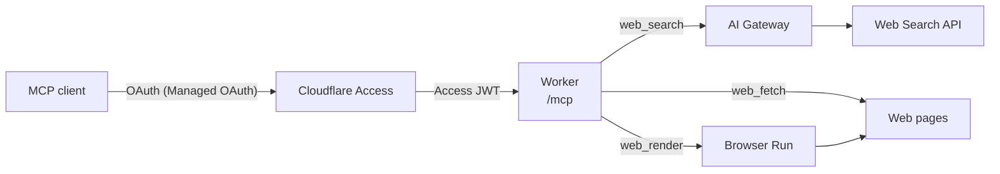

# webtools-mcp

A remote [MCP](https://modelcontextprotocol.io) server on Cloudflare Workers that gives coding agents web access: search the web, read pages, and render pages that need JavaScript. Cloudflare Access signs clients in with OAuth, so only you can use it.



## Tools

| Tool         | What it does                                                                                                                                   | Backed by                                                                                                                           |
| ------------ | ---------------------------------------------------------------------------------------------------------------------------------------------- | ----------------------------------------------------------------------------------------------------------------------------------- |
| `web_search` | Searches the public web and returns URLs, titles, and short descriptions.                                                                      | [Web Search API](https://developers.cloudflare.com/web-search/) through [AI Gateway](https://developers.cloudflare.com/ai-gateway/) |
| `web_fetch`  | Reads a URL as Markdown (HTML, PDF, and Office documents are converted), JSON, or text. Long pages are read in windows with `offset`.          | `fetch` from the Worker, and [Markdown Conversion](https://developers.cloudflare.com/workers-ai/features/markdown-conversion/)      |
| `web_render` | Loads a page in a headless browser, runs its JavaScript, and reads the result as Markdown. Use it when `web_fetch` returns an empty app shell. | [Browser Run](https://developers.cloudflare.com/browser-run/) `/markdown` Quick Action                                              |

`web_search` and `web_fetch` wrap the AI SDK adapters from [`agents`](https://www.npmjs.com/package/agents) (`agents/websearch/ai-sdk` and `agents/webfetch/ai-sdk`), so they keep the adapters' descriptions and result formats.

## Features

- Behind Access, the Worker still verifies the Access JWT's signature, issuer, and audience on every request, and rejects the request if any check fails.
- The Worker allows 30 searches and 10 renders a minute. AI Gateway also caps daily and monthly spending on searches.
- Fetched and rendered pages reach the model inside `<untrusted_web_content>`, and a page can't close that tag early.
- The server `instructions` describe all three tools on one line, for clients that list a server by that line instead of declaring its tools.

## Connect a client

The endpoint is `https://<your-hostname>/mcp`, served over streamable HTTP. Clients sign in with OAuth: they find the authorization server from the `WWW-Authenticate` header that Access returns, register themselves, and open a browser for you to sign in.

For example, in [Pi](https://pi.dev), add the server to `~/.pi/agent/mcp.json`:

```json
{
  "mcpServers": {
    "webtools": { "url": "https://<your-hostname>/mcp" }
  }
}
```

Then run `pi mcp login webtools` and check it with `pi mcp list`.

> [!TIP]
> Pi doesn't declare MCP tools to the model by default. Add `"exposure": "direct"` to the entry so the model sees the three tools without searching for them.

## Deploy your own

### Prerequisites

- A Cloudflare account on the Workers Paid plan, with a domain on Cloudflare
- [mise](https://mise.jdx.dev), which installs the Node.js and pnpm versions pinned in `package.json`
- A GitHub repository with Actions, for production deploys

### 1. Set up Cloudflare

1. Create an Access application of type `mcp` for the hostname the Worker will serve. Turn on Managed OAuth with dynamic client registration, and allow loopback redirect URIs so CLI clients can sign in. Add a policy that allows only you. Note the application's AUD tag.
2. Create an AI Gateway named `webtools`. Turn on authentication, and set spend limits that suit you.

### 2. Point the code at your resources

- `src/auth.ts`: set `ACCESS_ISSUER` to your Zero Trust team domain, `https://<team>.cloudflareaccess.com`.
- `cloudflare.config.ts`: set `ACCESS_AUD` to the AUD tag and `domains` to your hostname. The Worker creates the Custom Domain, its DNS record, and its certificate on deploy.

### 3. Deploy

`.github/workflows/deploy.yaml` runs `cf deploy` on every push to `main`. It reads two secrets from the `production` environment:

| Secret                  | Value                                                                                                                                          |
| ----------------------- | ---------------------------------------------------------------------------------------------------------------------------------------------- |
| `CLOUDFLARE_API_TOKEN`  | An account API token with Workers Scripts: Edit and Account Settings: Read on the account, and Workers Routes: Edit and Zone: Read on the zone |
| `CLOUDFLARE_ACCOUNT_ID` | Your account ID                                                                                                                                |

> [!IMPORTANT]
> Restrict the `production` environment to the `main` branch before you add the secrets. The workflow has no `pull_request` trigger, so pull requests never reach them.

To deploy from your machine instead, sign in with `cf auth login` and run `pnpm run deploy`.

## Local development

```sh
mise install
pnpm install
pnpm dev
```

`pnpm dev` runs `cf dev`, which serves the MCP endpoint at `http://localhost:5173/mcp`. Access isn't in front of it, so in development mode the Worker skips JWT verification for requests to `localhost`. Production builds never include that bypass.

> [!WARNING]
> Web Search and Browser Run have no local mode. `cf dev` connects their bindings to your Cloudflare account, so local searches and renders are real and billed.

Before every commit, run:

```sh
pnpm fmt
pnpm run typecheck
pnpm test
```

The unit tests cover only the auth module. Check the tools against a running Worker.

## Costs

Besides the Workers Paid subscription, you pay for searches and renders. The Web Search API bills each search, and AI Gateway's spend limits cap the total. Browser Run bills renders by browser time: Workers Paid includes 10 hours a month, and each hour beyond that costs $0.09.

Requests, logs, Markdown conversion, rate limiting, and Access stay within the plan's included usage for personal use.
